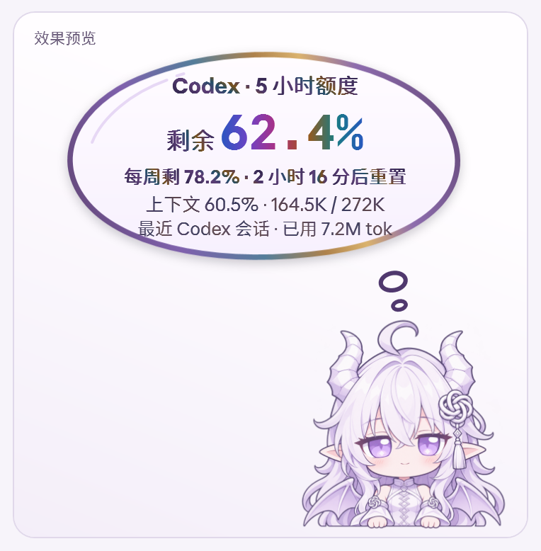
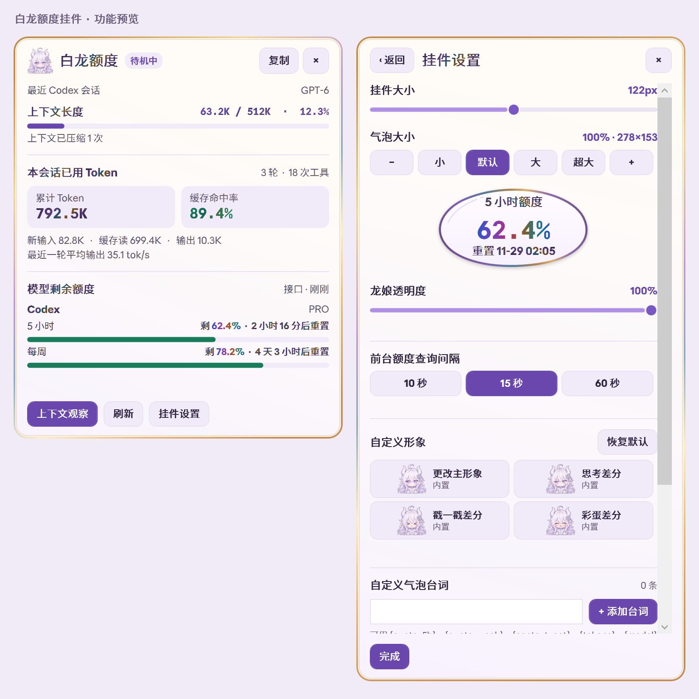

# 白龙额度 · Codex 插件

白龙额度是 Windows 版 Codex 的静音挂件。它随 Codex 桌面窗口出现，显示账号额度、上下文占用和会话用量。



## 安装

需要 Windows 11 x64，以及从 Microsoft Store 安装并已登录的 Codex 桌面版。安装在当前 Windows 用户下，使用系统自带的 .NET Framework。

1. 下载最新的 `white-dragon-codex-plugin-*-windows-x64.zip`，解压整个 ZIP。 [GitHub Releases](https://github.com/3104520/white-dragon-codex-plugin/releases/latest)
2. 在解压目录中双击 `Install.cmd`。
3. 打开 Codex 桌面版。挂件默认出现在窗口右下角。若插件列表还未更新，重启一次 Codex。

安装包使用 Codex CLI 注册本地插件 `white-dragon@white-dragon-local`。Windows 启动组件 `WhiteDragonStartup.exe` 随当前用户登录运行，在 Codex 窗口出现时加载挂件，窗口结束时卸载挂件。它在后台运行，任务栏和托盘没有额外入口。在已配置白龙加载功能的 Dragon Codex Boot 安装上，会使用现有的启动监视器。

## 使用

- **拖动白龙**可以在 Codex 窗口内自由摆放，松手后保存位置。手动选择角落时会使用该角落的位置。
- **左键单击**显示短周期和每周额度。再点一次可以切换自定义对白。一次对话完成时自动弹出额度气泡，约 10 秒后收起。空间不足时气泡会改到白龙侧边，或切换为仅显示额度和重置时间的紧凑布局。
- **右键单击**打开统计面板，可查看上下文长度、累计 Token、缓存命中率及会话明细。
- **刷新额度**会立即查询，面板和主气泡会显示额度来源和数据时间。面板右上角的「复制」可复制额度摘要和重置时间。
- **挂件设置**支持调整形象大小、气泡大小和透明度，替换待机、思考、戳一下和庆祝形象，编辑气泡对白，切换统计栏及完成提醒。设置页内的气泡会持续预览当前大小。

额度气泡和详情面板可见时，边框会在浅金、淡紫和雾蓝之间流动，标题和额度数字也有流光。小尺寸气泡使用独立的紧凑排版。挂件优先使用系统已有的 Anthropic Sans、Serif 和 Mono。中文采用随插件加载的资源圆体 CN，透明窗口使用灰度抗锯齿。流光跟随 Windows 的动画效果设置。 [资源圆体](https://github.com/CyanoHao/Resource-Han-Rounded) · [字体许可](https://github.com/CyanoHao/Resource-Han-Rounded/blob/v0.990/LICENSE.txt)



Codex 在前台时，挂件默认每 15 秒通过本机 Codex 的 `account/rateLimits/read` 查询额度。间隔可在设置中选 10、15 或 60 秒。点击气泡、打开面板、对话完成或额度窗口到达重置时间时，会提前查询。会话日志里有更新的额度记录时，挂件会先显示这笔数据。接口暂时失败会延长自动重试间隔，面板仍可手动刷新。

挂件从 Codex 本地会话日志汇总统计，位置和自定义素材保存在 `~/.codex/plugins/data/white-dragon@white-dragon-local/`。设置了 `CODEX_HOME` 的用户使用该目录下相同的相对路径。

## 更新与卸载

更新时解压新版 ZIP 并再次运行 `Install.cmd`。平时可在 Codex 的插件列表开关白龙额度。

使用发行包安装的用户可以在 PowerShell 中运行以下命令，卸载插件并清理本版本注册的 Windows 启动项。

```powershell
powershell.exe -NoProfile -ExecutionPolicy Bypass -File "$env:LOCALAPPDATA\Programs\WhiteDragonCodexPlugin\install.ps1" -Uninstall
```

### 已有本地安装

如果过去从其他目录注册过 `white-dragon-local`，安装脚本会提示现有路径。需要迁移到发行包时，先注销旧的来源，再运行 `Install.cmd`。

```powershell
codex plugin marketplace remove white-dragon-local
```

## 从源码构建

在 Windows x64 上，用 Windows PowerShell 从仓库目录运行以下命令。编译器使用 Windows 自带的 64 位 .NET Framework C# 编译器。

```powershell
powershell.exe -NoProfile -ExecutionPolicy Bypass -File .\build.ps1
powershell.exe -NoProfile -ExecutionPolicy Bypass -File .\pack.ps1
```

`build.ps1` 生成插件 DLL 和启动组件。`pack.ps1` 在 `dist/` 生成可安装的 ZIP 及 SHA-256 校验文件。可使用 `install.ps1 -ValidateOnly` 核对解压后的发行包和本机 Codex 版本。

运行 `tests/run-quota-tests.ps1` 可以复查额度更新顺序、离线重试和会话日志的增量读取。

启动组件复用了 Dragon Codex Boot 的插件加载代码，该部分的 MIT 许可随源码和发行包附带。 [MIT 许可](licenses/DragonCodexBoot-MIT.txt)
